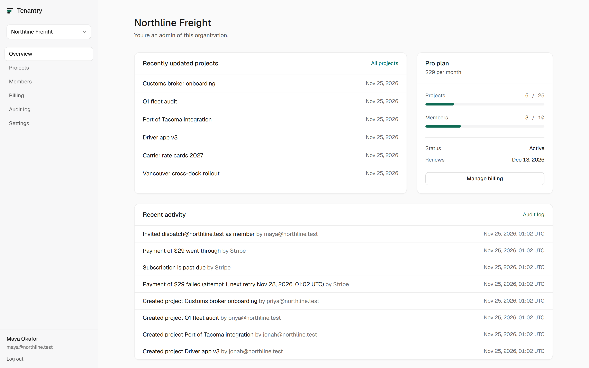
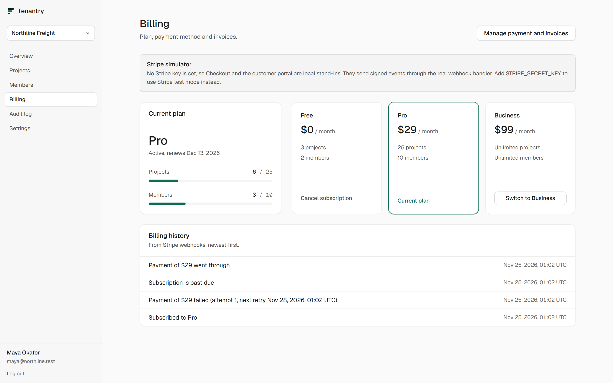
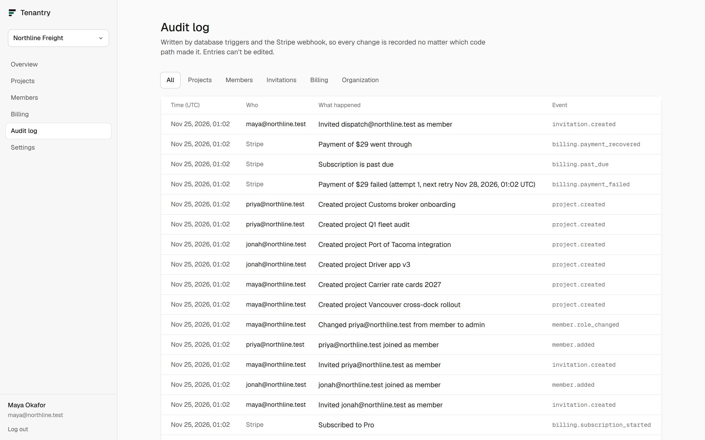
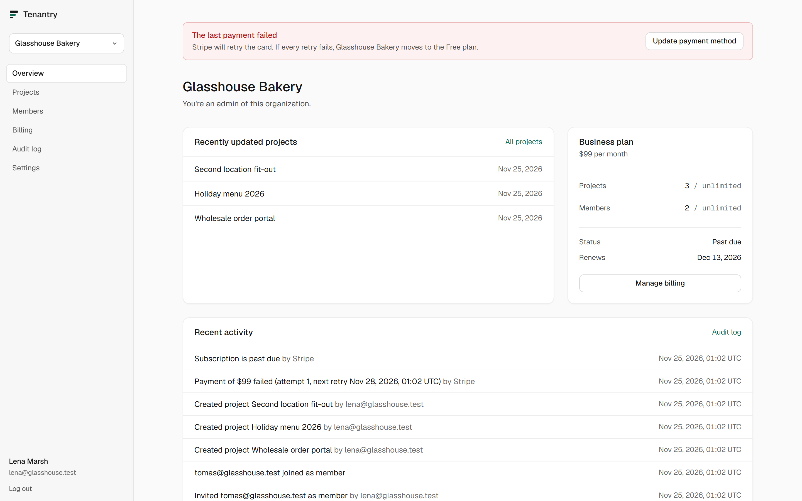
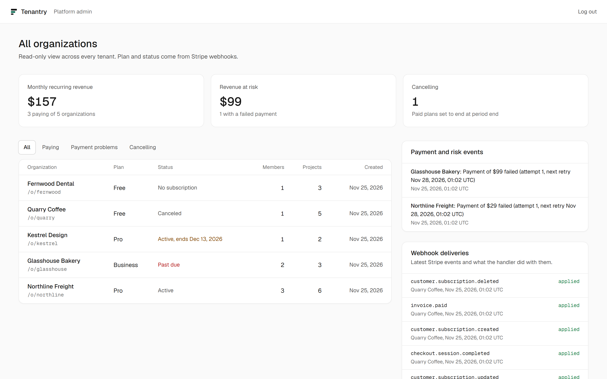
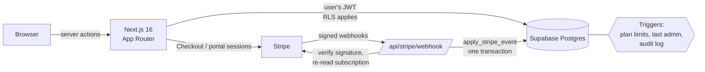

# Tenantry

A multi-tenant SaaS starter built with Next.js, Supabase and Stripe. Each company signs up, invites its team with admin and member roles, and pays through a Stripe subscription. Postgres row-level security keeps one company's data away from every other company, plan limits are enforced inside the database, and every change lands in an audit log nobody can edit.

[How it works](#how-it-works) · [Design choices](#design-choices) · [Run it locally](#run-it-locally) · [Use real Stripe](#use-real-stripe-test-mode) · [Deploy](#deploy) · [Tests](#tests)



## What it does

- **Organizations and roles.** Sign up, create an organization, invite people by email with a one-time link. Admins invite, change roles, remove people, manage billing and read the audit log. Members work on projects. An organization can never lose its last admin.
- **Tenant isolation.** Every table has row-level security. A user can only see rows from organizations they belong to, and someone else's organization URL returns the same 404 as one that doesn't exist.
- **Stripe subscriptions, start to finish.** Checkout for new subscriptions, the customer portal for plan changes, cards and cancellation, and a webhook handler that is safe to receive the same event twice or out of order.
- **Plan limits on the server.** Free allows 3 projects and 2 seats, Pro 25 and 10, Business has no limit. Limits are checked by Postgres triggers, so they hold for direct API calls and for requests racing each other.
- **Failed payments and cancellations.** A failed renewal shows a banner to everyone in the organization and keeps the plan while Stripe retries the card. A cancelled plan keeps working until the period ends, then drops to Free. Nothing is deleted when an organization ends up over its new limits; it just can't add more.
- **Audit log.** Written by database triggers and the webhook handler. Filter by projects, members, invitations, billing or organization.
- **Platform admin dashboard.** A read-only view across every tenant for the people running the product: MRR, revenue at risk from failed payments, cancellations, and the latest webhook deliveries with what the handler did with each.
- **Stripe simulator.** With no Stripe key, Checkout and the customer portal are replaced by local pages that send signed events through the real webhook handler. You can try every billing scenario without a Stripe account.

| | |
| --- | --- |
|  |  |
|  |  |

## How it works



**Requests run as the user.** Pages and server actions use a Supabase client carrying the signed-in user's JWT, so every query goes through row-level security. The secret key is used in exactly three places: the webhook handler, the billing simulator and the platform admin page, and each one checks who is asking first.

**The database owns the rules.** Policies decide who can read and write what. Column grants narrow that further: an admin can rename an organization but not change its URL slug, and a role update can't move a membership to another organization. Triggers enforce plan limits, keep at least one admin, and write audit rows. The app shows friendly messages, but taking the app away doesn't remove any protection.

**A webhook event, step by step:**

1. Read the raw body and verify the `Stripe-Signature` header. Bad signatures get a 400 and are never retried.
2. For subscription events, fetch the subscription from Stripe and store that. A late event can carry an old state; the fetched copy is always current.
3. Find the organization by the Stripe customer id we saved before Checkout. Metadata is only a fallback.
4. Call `apply_stripe_event`, a Postgres function that does all of this in one transaction:
   - insert the event id into `stripe_events`; if it's already there, return `duplicate` and change nothing
   - skip the event if it's older than the last one applied to this subscription (`stale`)
   - update the plan and status; `active`, `trialing` and `past_due` keep the paid plan, anything else falls back to Free
   - write audit rows for what changed: started, plan changed, cancellation scheduled or undone, past due, payment failed or recovered, ended
5. Return 200. If anything throws, the transaction rolls back, the event id isn't recorded, and Stripe's retry gets a clean second attempt.

Handled events: `checkout.session.completed`, `customer.subscription.created/updated/deleted/paused/resumed`, `invoice.paid`, `invoice.payment_failed`, and the risk events `charge.refunded`, `charge.dispute.created` and `radar.early_fraud_warning.created`, which go to the audit log and the platform admin page.

## Design choices

**Limits in triggers, not in the app.** The usual approach is to count rows in the server action and then insert. Two requests can both count 2 of 3 and both insert. Here the count and the insert happen in the same transaction behind a per-organization advisory lock. The test suite fires 8 inserts at once at an empty Free organization and checks that exactly 3 succeed.

**Outsiders get "permission denied", not plan details.** Postgres runs BEFORE triggers before it checks RLS on the new row. Without care, someone inserting into another company's organization would get "the Free plan allows 2 members" back, which leaks that company's plan. The limit triggers step aside for users who wouldn't pass RLS, so RLS rejects them first. There's a test for it.

**Webhook idempotency in the same transaction as the change.** Recording the event id in one statement and applying it in another leaves a gap: crash in between and the event is either lost or applied twice. Doing both in one Postgres function closes it. Concurrent deliveries of the same event serialize on the primary key, and the second one returns `duplicate`.

**Invite tokens are stored hashed.** The database only keeps the SHA-256 of each invitation token. The raw token exists in the link the admin copies or the email that's sent, and is shown once. A database leak can't be used to join an organization. Accepting checks that the signed-in email matches the invitation, that it isn't expired, revoked or used, and that there's a free seat.

**The audit log is append-only.** Rows are only written by `security definer` functions, there are no insert, update or delete grants for users, and an update trigger rejects edits even with the secret key.

**Downgrades never delete data.** When a subscription ends, the organization moves to Free and keeps everything. Banners explain they're over the limit, and the triggers block new projects or invites until they upgrade or clean up.

**A simulator instead of mocks.** Without a Stripe key, the checkout and portal pages build Stripe-shaped events, sign them with the webhook secret and send them through `handleWebhookRequest`, the same function the real endpoint uses. The portal can deliver every event twice to show idempotency at work. With a key set, these pages return 404.

## Run it locally

Requires Node 20.9+ and Docker. No Stripe account needed.

```bash
git clone https://github.com/evannawfal/tenantry && cd tenantry
npm install
npm run setup     # starts Supabase in Docker, writes .env.local, loads demo data
npm run dev       # http://localhost:3000
```

Every demo account uses the password `demo-password`:

| Email | What you'll see |
| --- | --- |
| `maya@northline.test` | Admin of Northline Freight, on Pro, with a payment that failed and recovered |
| `jonah@northline.test` | Member of Northline Freight: no audit log, no billing controls |
| `lena@glasshouse.test` | Admin of Glasshouse Bakery, on Business, with a renewal payment failing now |
| `ana@kestrel.test` | Admin of Kestrel Design, on Pro, cancelled and running to the end of the period |
| `rui@quarry.test` | Admin of Quarry Coffee, subscription ended, now over the Free limits |
| `sam@fernwood.test` | Admin of Fernwood Dental, on Free, at the project limit |
| `ops@tenantry.test` | Platform admin, lands on `/admin` |

Supabase Studio runs at http://127.0.0.1:55423. The local stack uses ports 55420 to 55429 so it doesn't collide with another Supabase project on the default ports.

Useful commands:

```bash
npm test             # RLS, plan limit and webhook tests against the local database
npm run test:e2e     # browser tests: signup to cancellation, two users
npm run db:reset     # re-run migrations on an empty database, then `npm run seed`
npm run db:types     # regenerate src/lib/supabase/database.types.ts after a schema change
```

## Use real Stripe (test mode)

1. Get test keys. Either use your Stripe account's test mode, or run `stripe sandbox create` with the [Stripe CLI](https://docs.stripe.com/stripe-cli) for a sandbox without signing up. A [restricted key](https://docs.stripe.com/keys#limit-access) (`rk_test_...`) is safer than the full secret key.
2. Put it in `.env.local` as `STRIPE_SECRET_KEY`, then create the products, prices and portal configuration:
   ```bash
   npm run stripe:setup
   ```
   This step needs a full test key or one with write access to Products, Prices and Customer portal. It creates one product per paid plan, writes `STRIPE_PRICE_PRO`, `STRIPE_PRICE_BUSINESS` and `STRIPE_PORTAL_CONFIGURATION` to `.env.local`, and prints the next command.
3. Forward webhooks to your dev server and copy the `whsec_...` secret it prints into `STRIPE_WEBHOOK_SECRET`:
   ```bash
   stripe listen --forward-to localhost:3000/api/stripe/webhook
   ```
4. Restart `npm run dev`. Upgrading now goes to Stripe Checkout (card `4242 4242 4242 4242`), and "Manage payment and invoices" opens the real customer portal. To test failures, use the card `4000 0000 0000 0341`, which attaches but fails on renewal, together with a [test clock](https://docs.stripe.com/billing/testing/test-clocks).

Tax isn't turned on. If you charge customers in the US or EU, look at [Stripe Tax](https://docs.stripe.com/billing/taxes/collect-taxes) and add `automatic_tax` to the Checkout session once you have a tax registration.

## Deploy

The app is a standard Next.js project and runs on Vercel or any Node host.

1. Create a Supabase project and push the schema: `npx supabase link --project-ref <ref> && npx supabase db push`.
2. In Supabase, under Authentication > URL Configuration, set the site URL to your domain and add `https://your-domain/auth/confirm` to the redirect URLs. Email confirmation is on by default for hosted projects; the confirm route handles the link.
3. In Stripe, add a webhook endpoint at `https://your-domain/api/stripe/webhook` subscribed to the events listed in `HANDLED_EVENTS` in `src/lib/billing/webhook.ts`.
4. Set the environment variables from `.env.example` on your host. Use live Stripe keys and live price ids only after testing the whole flow in test mode.
5. To make yourself a platform admin: `update profiles set is_platform_admin = true where email = 'you@example.com';` in the Supabase SQL editor.

For a public demo without Stripe, set `BILLING_SIMULATOR=true` and leave the Stripe key empty.

## Tests

**Database and webhook tests** (`tests/`, Vitest, 47 tests) run against the local Supabase stack through PostgREST with real user sessions, the same way the app talks to the database:

- `tenant-isolation.test.ts`: two companies try to read, update, delete, move and insert each other's rows, invite into each other's organizations, write billing state or audit rows directly, and read `stripe_events`. Also covers member versus admin permissions, the last-admin rule, slug immutability and invitation edge cases.
- `plan-limits.test.ts`: the 4th project on Free, 8 concurrent inserts, upgrading and downgrading, seats counting open invitations.
- `stripe-webhook.test.ts`: missing, wrong and tampered signatures; the same event delivered 3 times and concurrently; out-of-order events; an old subscription's cancellation arriving after a new subscription started; failed payment, recovery, retries running out, cancellation at period end, plan changes, refunds, disputes and fraud warnings; customer id taking priority over metadata.

**Browser tests** (`e2e/`, Playwright) walk one company from signup to cancellation with a second person invited in: hitting the project limit, a declined card, upgrading, the invite link working once, member restrictions, a failed payment delivered twice, recovery, cancelling, reaching period end, the audit log filters, and another tenant's URL returning 404.

CI runs all of it on every push, against a fresh Supabase stack.

## Project layout

```
supabase/migrations/   schema, RLS policies, triggers, apply_stripe_event
src/lib/billing/       Stripe client, plans, webhook handler, simulator
src/lib/auth.ts        current user and organization context (RLS-scoped)
src/actions/           server actions: auth, org, projects, members, billing
src/app/o/[slug]/      organization pages: overview, projects, members, billing, audit, settings
src/app/admin/         platform admin dashboard
src/app/simulator/     local Checkout and customer portal
scripts/               env setup, demo seed, Stripe setup, screenshots
tests/, e2e/           Vitest and Playwright suites
```

Projects are the example of tenant data. To add your own, copy the `projects` table pattern: an `org_id` column, the four policies, an audit trigger, and a limit trigger if a plan should cap it.

## License

MIT
